# 🧠 BrainFlow 智脑流

> 一站式企业级任务分配工作流智能助手 —— 统领全局的任务分配中枢，多渠道可接入（微信 / CLI / HTTP / 更多平台）。


### 项目信息

| 项 | 内容 |
| --- | --- |
| **作者** | axuan |
| **版本** | v1.2（2026-08-12） |
| **技术栈** | Python 3.11+ · LangGraph 1.x · FastAPI · SQLite · React 19 + Vite |
| **代码位置** | `D:\code\brainflow` |
| **相关文档** | [v1.0 方案总结](docs/V1.0_SUMMARY.md) · [异步任务架构 v1.2](docs/async-job-architecture.md) · [DEBUG.md](docs/DEBUG.md) |
| **协议** | 专有 · © 2026 黄宇然，保留所有权利 |

> 详细方案文档见 `docs/`：`async-job-architecture.md`（**v1.2 异步 Job 权威**）· `V1.0_SUMMARY.md` · `DEBUG.md` · `frontend_options_2026.md`。

---

## 目录

- [项目简介](#项目简介)
- [核心特性](#核心特性)
- [运营看板预览](#运营看板预览)
- [架构设计](#架构设计)
- [快速开始](#快速开始)
- [项目结构](#项目结构)
- [API 接口](#api-接口)
- [配置说明](#配置说明)
- [开发与运维](#开发与运维)
- [常见问题](#常见问题-faq)
- [Roadmap](#roadmap)
- [License](#license)

---

## 项目简介

BrainFlow（智脑流）是基于 **标准 LangGraph 架构** 的企业级任务分配工作流平台。核心思想：

> **LLM 只做"听懂任务"（意图识别），任务怎么分配、怎么执行，由标准 LangGraph 工作流图编排完成——一个图统领全局，多渠道接入。**

**解决什么问题**：将"意图理解 → 任务分发 → 工具执行"的链路标准化、可观测化、可插拔化——加一个业务工具只需注册一行配置，工作流图自动扩展；每次执行全程可观测（节点状态 / 耗时 / 输入输出 / Token）。

### 生态定位：官方一套打底 + 自研前端

**LangGraph 官方生态（一套）**：`LangGraph 框架` + `LangSmith（观测/评估/Studio 调试）` + `Agent Chat UI（前端）`。

**BrainFlow 的采用**：采用官方**框架 + Server**做地基；**以 LangSmith 为主线**（观测/评估/Studio 调试搭配）；调试前端用 Agent Chat UI（本地子项目）；**自研运营看板**（`web/`，`:5174`）对接 FastAPI —— 官方生态做地基，自研前端做产品。

```
官方（主线）：LangGraph 框架 + Server(:2024) + LangSmith/Studio + Chat UI(调试)
自研：运营看板 web/(:5174) + SSE 流式对话 + Job 看板 + 节点级观测 + FastAPI(:5173)
```

---

## 核心特性

| 特性 | 说明 |
| --- | --- |
| **标准 LangGraph 工作流** | 一个 StateGraph：`router（意图识别）→ 条件边分发 → 14 工具节点 → summary（LLM 总结）→ 回复` |
| **任务分配中枢** | 意图识别后由条件边自动分发到对应工具节点；加工具 = 注册一行，图自动扩展 |
| **SSE 流式对话** | `/api/chat/stream`（Run Stream）+ `/api/chat/sessions/{id}/events`（Join Stream）；异步工具走 Job 看板 |
| **异步工具 Job** | `info_hunt` / `weather` 等 `ASYNC_TOOLS`：submit → 后台执行 → 看板 `/jobs` + 对话同条 assistant 更新 |
| **运营看板前端** | `web/` 自研 React 看板：总览 / 链路追踪 / 工作流图 / AI 对话（SSE 流式） |
| **意图识别准确性** | 动态工具清单注入 + few-shot 示例 + 白名单校验防幻觉（评估脚本目标 ≥ 90%） |
| **统一 API 接口层** | FastAPI：7 个运维 API（对齐 Hermes）+ 同步/流式对话 + 工作流图 + 健康检查 |
| **节点级可观测** | 生产侧 SQLite 三件套（状态/耗时/输入输出/token）；开发侧 **LangSmith** 为主线（trace / 评估 / Studio） |
| **官方生态原生兼容** | LangGraph Studio 图可视化 · Agent Chat UI · **LangSmith 开发运维主线** |
| **多渠道接入** | 微信（留空待接）/ CLI / HTTP / 更多平台——同一套工作流图 |
| **可插拔工具** | 注册表驱动（`register(name, fn, desc, keywords, examples)`），框架零改动 |

---

## 运营看板预览

`web/` 自研运营看板（`:5174`）四大页面实机截图——总览指标、链路追踪、工作流图、AI 对话（含链路可视化 + SSE 流式回复）。

### 总览看板

系统运行状态、调用量、Token 消耗、工具活跃度一览。

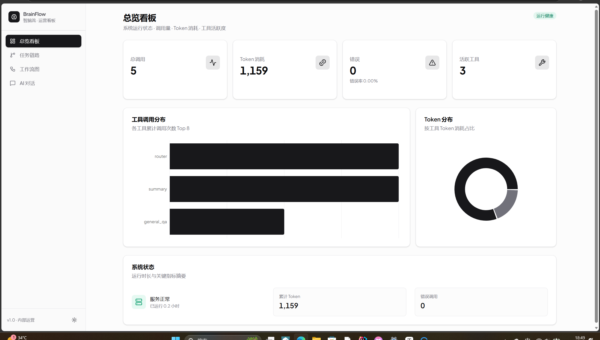

### 任务链路追踪

节点级观测：执行链路（router → tool → summary）、耗时分布、输入输出与 Token 明细。

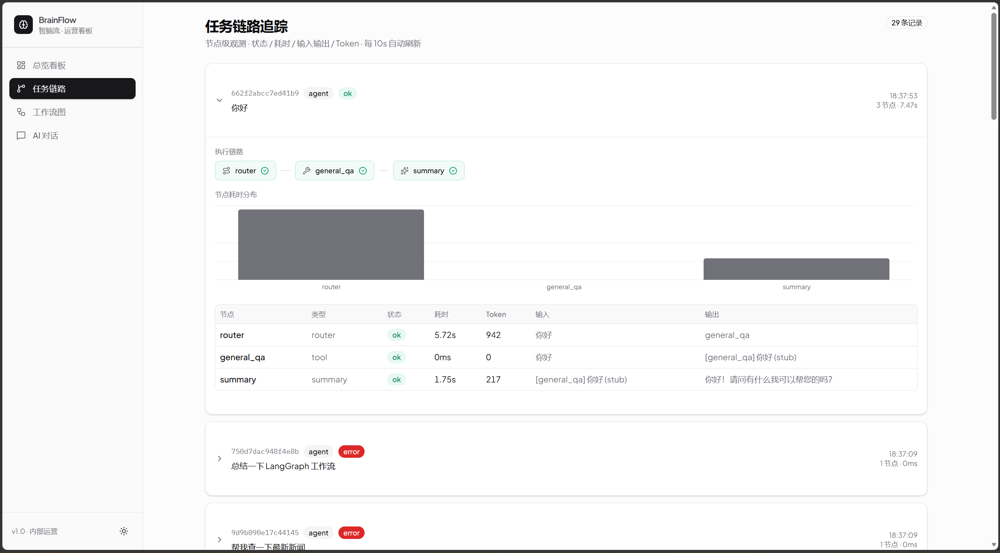

点击节点可打开详情弹窗，查看单节点耗时、Token、输入输出及 `direct_reply` 透传标记。

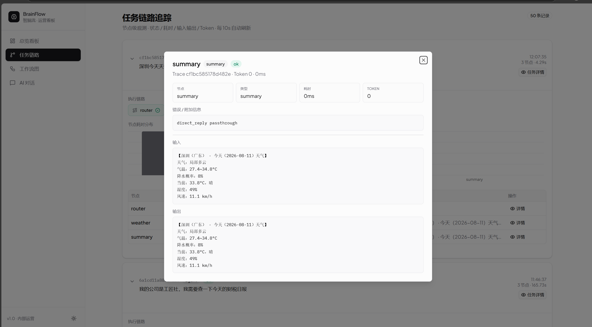

### 工作流图

LangGraph 工作流交互式可视化（React Flow + Mermaid 自动布局），router 条件边 → 14 工具节点 → summary。

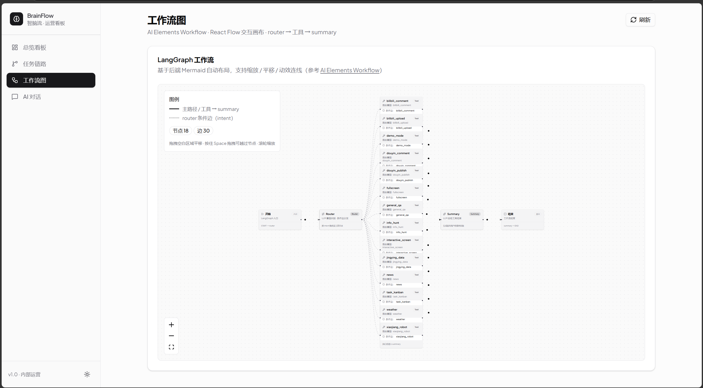

### AI 对话

参考 AI Elements Chatbot：链路可视化、工具调用状态、流式总结回复。

| 链路可视化（意图识别 → 工具调用 → 总结） | 流式回复与工具详情 |
| --- | --- |
| 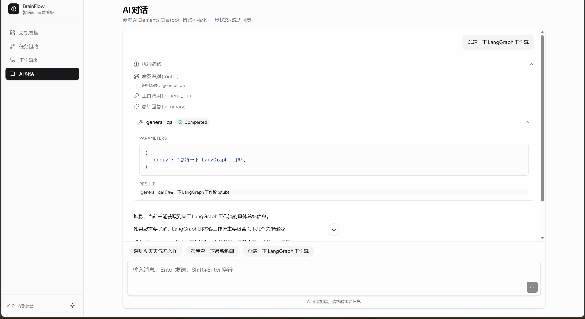 | 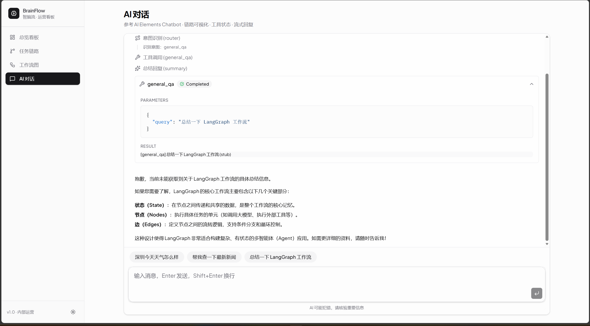 |

**v1.2 更新**：会话历史侧边栏、欢迎页、天气/财税工具实机效果。

| 新 AI 对话界面（历史 + 欢迎页） | 天气工具（Open-Meteo） | 财税日报（caishui-report） |
| --- | --- | --- |
| 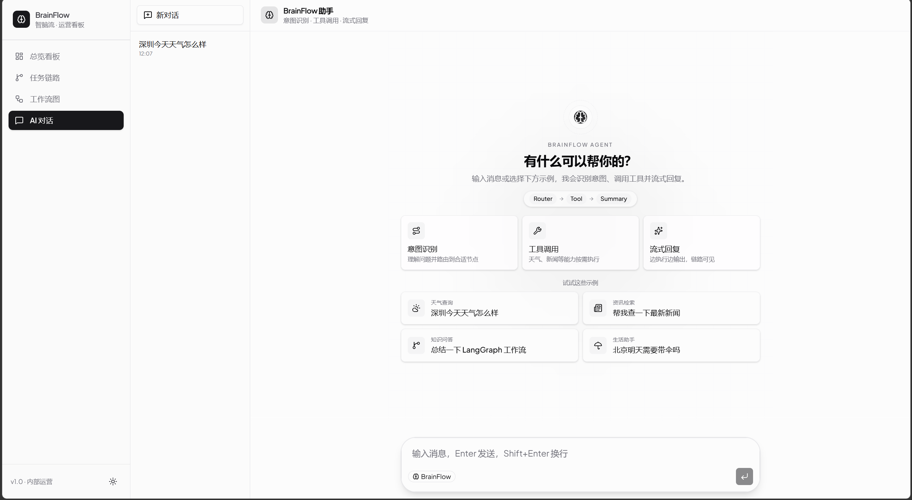 | 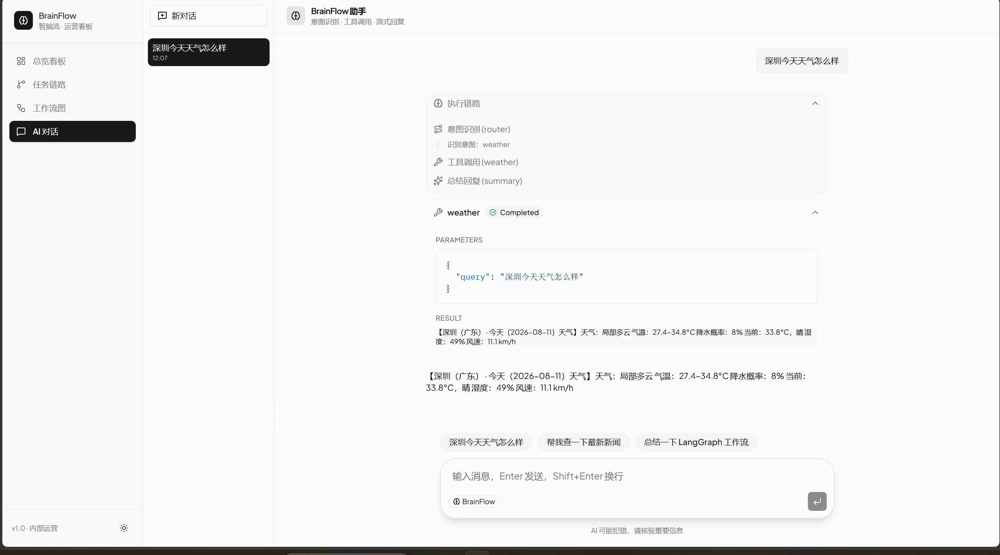 | 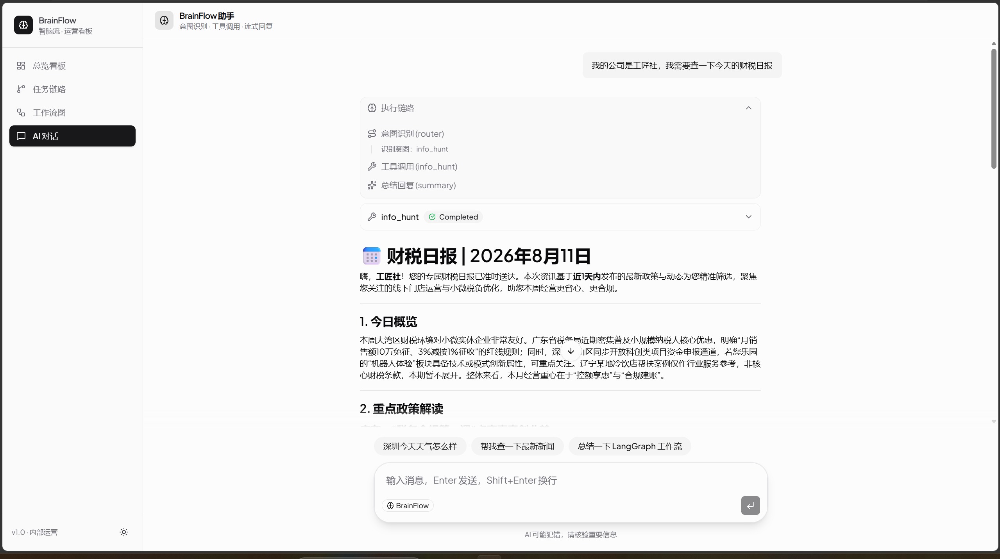 |

### 演示视频

前端看板（`web/` `:5174`）实机录屏，展示 AI 对话页的链路可视化、工具调用与流式回复。

**演示 1：简单问答 + 天气查询**

通用问答（general_qa）与天气工具（Open-Meteo）联调：意图识别 → 工具执行 → summary / direct_reply 全链路。

<video src="assest/brainflow前端看板演示1.mp4" controls width="100%"></video>

**演示 2：财税日报生成**

`info_hunt` 对接 caishui-report 日报 API，展示财税日报生成与格式化输出。  
> 视频已做裁切加速；实际 API 等待时间通常更长，请以本地实跑为准。

<video src="assest/brainflow前端看板演示2.mp4" controls width="100%"></video>

---

## 架构设计

### 分层架构

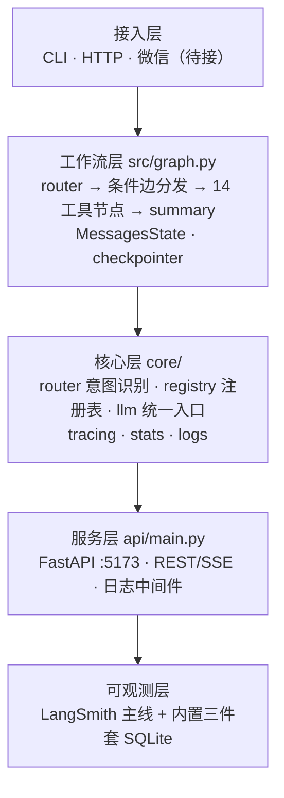

### 消息处理链路

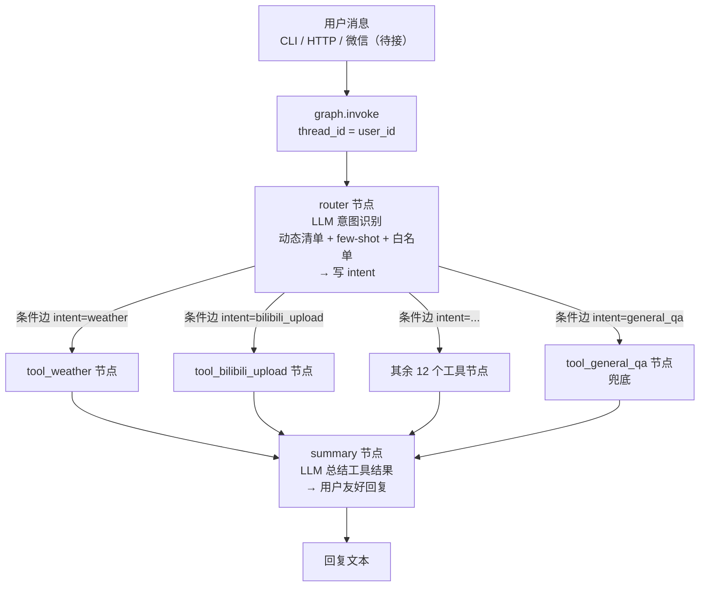

---

## 快速开始

### 环境要求

| 依赖 | 版本 | 说明 |
| --- | --- | --- |
| Python | >= 3.11 | LangGraph / FastAPI 要求 |
| Node.js | >= 18 | 运营看板 `web/`（`npm run dev`） |

### 1. 安装依赖

```bash
python -m venv .venv
# Windows
.venv\Scripts\pip install -r requirements.txt
# macOS / Linux
.venv/bin/pip install -r requirements.txt
```

### 2. 配置环境变量

```bash
cp .env.example .env
cp config/llm_profiles.example.yaml config/llm_profiles.yaml
```

编辑 `config/llm_profiles.yaml`，为各模型填写 `api_key` / `base_url`；`.env` 只需指定当前使用的 profile 名：

```ini
LLM_MODEL=qwen3.7-flash
```

> 密钥与 endpoint 均在 `config/llm_profiles.yaml` 维护（已加入 `.gitignore`）；切换模型只改 `.env` 的 `LLM_MODEL`。  
> 若需 **LangGraph + LangSmith 开发运维**，请在 `.env` 中配置 `LANGSMITH_API_KEY`、`LANGSMITH_PROJECT`，并将 `LANGSMITH_TRACING=true`。

### 3. 启动（三个终端）

日常开发需 **分别开三个终端** 并行运行（Windows PowerShell 示例）：

**终端 ① — FastAPI 后端（生产 API · 必选）**

```powershell
.venv\Scripts\python server\main.py
```

- http://localhost:5173/docs — Swagger  
- http://localhost:5173/healthz — 健康检查  
- 运营看板、对话 SSE、Job 看板均代理到此端口

**终端 ② — LangGraph + LangSmith（开发运维 · 调试图 / trace）**

```powershell
$env:PYTHONUTF8="1"
$env:PYTHONIOENCODING="utf-8"
.venv\Scripts\langgraph dev --host 127.0.0.1 --port 2024
```

- http://127.0.0.1:2024 — LangGraph Server / Studio  
- Trace 上传 LangSmith（需 `.env` 中 `LANGSMITH_*` 已配置）  
- **与终端 ① 互补**：① 走自研 FastAPI + SQLite 观测；② 走官方 Server + LangSmith 主线

**终端 ③ — Web 运营看板（生产 UI · 使用产品功能时必选）**

```powershell
cd web
npm install   # 首次
npm run dev
```

- http://localhost:5174 — 总览 / 链路追踪 / 工作流图 / AI 对话 / Job 看板  
- Vite 将 `/api`、`/healthz` 代理到 `:5173`，**须先启动终端 ①**

| 终端 | 命令 | 端口 | 用途 |
| --- | --- | --- | --- |
| ① 后端 | `python server\main.py` | 5173 | REST/SSE、Job、chat 持久化 |
| ② LangGraph | `langgraph dev …` | 2024 | Studio、LangSmith trace、图调试 |
| ③ 前端 | `cd web && npm run dev` | 5174 | 自研运营看板（对接 ①） |

> **最小用法**：只用看板对话 → 开 **① + ③**。只做 LangGraph/ LangSmith 调试 → 开 **②**（可不启 ③）。全链路联调 → **① + ② + ③** 同时运行。

<details>
<summary>macOS / Linux 命令</summary>

```bash
# ① 后端
.venv/bin/python server/main.py

# ② LangGraph + LangSmith
export PYTHONUTF8=1 PYTHONIOENCODING=utf-8
.venv/bin/langgraph dev --host 127.0.0.1 --port 2024

# ③ 前端
cd web && npm install && npm run dev
```

</details>

### 4. 验证

```bash
.venv\Scripts\python tests\validate.py        # 全链路验证（9 项，无需 LLM）
.venv\Scripts\python tests\intents_eval.py    # 意图识别准确率评估（需 LLM，目标 ≥ 90%）
```

---

## 项目结构

```
brainflow/
├── src/graph.py          ★ 标准工作流图（router + 条件边 + 工具节点 + summary 总结节点）
├── api/                  ★ API 接口层（FastAPI）
│   └── main.py               REST/SSE + /docs + 健康检查（UI 见 web/）
├── config/
│   ├── settings.py       全局配置（.env）
│   ├── profiles.py       LLM Profile 加载（llm_profiles.yaml）
│   └── prompts.py        意图识别 Router Prompt 全文
├── prompts/              ★ 提示词目录（各节点提示词按模块组织）
│   ├── __init__.py           统一导出
│   └── summary.py            summary 节点 Prompt（工具结果 → 用户友好回复）
├── core/
│   ├── router.py         RouterAgent.classify（LLM 意图识别 + 白名单）
│   ├── registry.py       ToolRegistry（工具注册表，可插拔）
│   ├── llm.py            LLMClient（OpenAI SDK 直连，token 统计）
│   ├── tracing.py        TraceSpan（节点级观测：状态/耗时/输入输出/token）
│   ├── stats.py          StatsCollector（指标）
│   └── logs.py           JsonLogger（JSON 结构化日志）
├── tools/wechat_tools.py 14 工具注册（stub，业务侧真实逻辑后续接入）
├── web/                  ★ 自研运营看板前端（详见 [web/README.md](web/README.md)）
│   ├── src/pages/            总览看板 / 任务链路 / 工作流图 / AI 对话
│   ├── src/lib/              API 客户端 + SSE 流式封装 + 类型
│   └── vite.config.ts        dev 代理 /api → 后端 :5173
├── chat-ui/              Agent Chat UI 本地子项目（官方脚手架，调试聊天）
├── scripts/dev_debug.sh  一键启动调试环境（langgraph dev + 可选 chat-ui）
├── server/main.py        入口：uvicorn 起 API + CLI 模式（微信留空）
├── langgraph.json        LangGraph Server 图入口（langgraph dev 调试）
├── docs/                 调试 / 选型文档（DEBUG.md / frontend_options_2026.md 等）
├── data/                 运行时数据（SQLite）
└── tests/
    ├── validate.py       全链路验证（9 项，无需 LLM）
    └── intents_eval.py   意图识别准确率评估（目标 ≥ 90%）
```

---

## API 接口

统一由 `api/main.py`（FastAPI，端口 **5173**）提供，Swagger：`/docs`。完整请求/响应与 SSE 事件说明见 **[docs/API.md](docs/API.md)**。

### 内置运维 API（生产看板 · SQLite）

生产环境日常运维由内置 FastAPI + 运营看板承担（**不接 LangSmith**）。开发调试、trace 分析、Prompt 评估请走 [LangSmith 开发运维](#langsmith-开发运维主线) 链路。

| 方法 | 路径 | 说明 |
| --- | --- | --- |
| GET | `/api/board` | 看板总览（调用数 / token / 错误 / 错误率 / 活跃工具） |
| GET | `/api/tasks` | 任务列表（**节点级观测**：状态 / 耗时 / 输入输出 / token） |
| GET | `/api/profiles` | 工具使用分析（次数 / token） |
| GET | `/api/analytics/usage` | 使用统计（总数 + 按工具分布） |
| GET | `/api/logs?n=` | 最近调用日志 |
| GET | `/api/events` | SSE 实时事件流 |
| GET | `/` | 前端页面 |

### 业务 / 能力 API

| 方法 | 路径 | 说明 |
| --- | --- | --- |
| POST | `/api/chat` | 对话（同步）：`{"text": "...", "user_id": "..."}` → `{"reply": "..."}` |
| POST | `/api/chat/stream` | 对话（SSE 流式）：按节点推送 `step`（router/tool/summary），`reply` 在 summary 产出时返回 |
| GET | `/api/graphs` | 当前工作流图（官方 draw_mermaid 输出，前端 mermaid.js 渲染） |
| GET | `/healthz` | 存活检查 |
| GET | `/readyz` | 就绪检查（指标系统可用） |

---

## 配置说明

`.env` 全字段说明：

| 变量 | 必填 | 默认值 | 说明 |
| --- | --- | --- | --- |
| `LLM_MODEL` | ✅ | `qwen3.7-flash` | 当前模型 profile 名（见 `config/llm_profiles.yaml`） |
| `LLM_ENABLE_THINKING` | 否 | `false` | 是否开启模型 thinking 模式 |
| `API_HOST` | 否 | `0.0.0.0` | API 监听地址 |
| `API_PORT` | 否 | `5173` | API 端口 |
| `DB_DIR` | 否 | `data/` | 观测数据库目录（可覆盖到可写目录） |
| `LANGSMITH_API_KEY` | 否 | — | **LangSmith 开发运维主线**（`langgraph dev` 自动接入） |
| `LANGSMITH_PROJECT` | 否 | `brainflow` | LangSmith 项目名 |
| `LANGSMITH_TRACING` | 否 | `true` | 是否开启 trace 上传 |
| `WECHAT_ACP_PATH` | 否 | — | 微信接入（留空 = 未启用，后续实现） |

`config/llm_profiles.yaml`（从 `llm_profiles.example.yaml` 复制，**勿提交 git**）：

| 字段 | 说明 |
| --- | --- |
| `model` | 模型 ID（发给 API 的名称） |
| `base_url` | OpenAI 兼容 endpoint |
| `api_key` | 该 profile 专用密钥 |

---

## 开发与运维

**LangSmith 为开发运维主线**：工作流调试、全链路 trace、Prompt 评估、Studio 图可视化均通过 LangGraph Server + LangSmith 完成。生产对话与运营看板走内置 FastAPI + SQLite，两者互补、可同时运行。

### 观测体系对照

| 场景 | 启动方式 | 观测 / 运维入口 | 说明 |
| --- | --- | --- | --- |
| **开发运维（主线）** | `langgraph dev`（:2024） | [smith.langchain.com](https://smith.langchain.com) + Studio | LangSmith trace / 评估 / Prompt 管理 |
| **生产运维** | `python server/main.py`（:5173，纯 API） | `web/` 运营看板（:5174） | SQLite 观测 + Job 看板 + REST/SSE |

### LangSmith 开发运维（主线）

LangSmith 是云端 SaaS，**不需要单独启动服务**——配置 `.env` 后，由 `langgraph dev` 自动读取 `langgraph.json` 并上传 trace。

```env
# .env（LangSmith 开发运维）
LANGSMITH_API_KEY=lsv2_xxx
LANGSMITH_PROJECT=brainflow
LANGSMITH_TRACING=true
```

```bash
pip install -U "langgraph-cli[inmem]"
langgraph dev          # :2024，终端输出 Studio 链接
```

启动成功后日志出现 `Successfully submitted metadata to LangSmith instance` 即表示已接入，随后可在 smith.langchain.com 查看 trace。

> ⚠️ **内置服务（`python server/main.py`）不接 LangSmith**。内置 FastAPI 的观测链路是自研 `core/tracing.py` → SQLite；即使配好 key，内置服务也不会往 LangSmith 上传。开发调试请用 `langgraph dev` 这条链路。

**Windows 注意**：若 `langgraph dev` 报 `UnicodeDecodeError: 'gbk' codec`，先执行：
```powershell
$env:PYTHONUTF8="1"; $env:PYTHONIOENCODING="utf-8"
```

### CLI 模式（快速测试）

```bash
.venv\Scripts\python server\main.py --cli "深圳今天天气怎么样"
```

### 调试前端（共 4 个，全部本地化）

| # | 前端 | 类型 | 场景 | 启动 |
| --- | --- | --- | --- | --- |
| 1 | 运营看板（`web/`） | 自研 | 生产（对话/图/看板/Job） | `cd web && npm run dev`（:5174） |
| 2 | Agent Chat UI（`chat-ui/`） | 官方脚手架 | 调试聊天 | `cd chat-ui && pnpm install && pnpm dev`（:3000） |
| 3 | LangGraph Studio | 官方 IDE | 调试图可视化 | `langgraph dev` |

> 💡 **运营看板（`web/`）**：React 19 + Vite + TypeScript + **Tailwind CSS 4 + shadcn/ui + Vercel AI SDK**（对齐 DeerFlow / DeepAgent 选型）。含总览看板 / 任务链路追踪（节点级观测）/ 工作流图（mermaid）/ AI 对话（SSE 流式）四个页面。dev server 默认代理 `/api` → 后端 :5173，需先启动后端。

### LangGraph Server + Studio

与上一节相同，一键脚本：

```bash
bash scripts/dev_debug.sh            # langgraph dev + Studio 链接
bash scripts/dev_debug.sh --chat-ui  # + Agent Chat UI
```

> ⚠️ **Agent Chat UI 连不上（Failed to fetch）**：请先启动 `langgraph dev`（:2024），再配置 `Deployment URL = http://127.0.0.1:2024` + `Assistant ID = agent`。

### 测试

| 命令 | 覆盖 |
| --- | --- |
| `python tests/validate.py` | 图构建 / draw_mermaid / 工具节点 / API / 日志中间件 / 指标 |
| `python tests/intents_eval.py` | 意图识别准确率（测试集 17 条，目标 ≥ 90%） |

---

## 常见问题 FAQ

**Q1：Agent Chat UI 报 "Unable to connect to LangGraph server"？**
先启动后端：`langgraph dev`（确认 :2024 监听），再配置 Chat UI 的 Deployment URL = `http://127.0.0.1:2024`，Assistant ID = `agent`。

**Q2：端口 5173 被占用？**
`API_PORT=5175 python server/main.py`（或改 `.env` 的 `API_PORT`）。

**Q3：加一个新工具要改哪些代码？**
只需在 `tools/wechat_tools.py` 的 `TOOLS` 列表加一行注册（id/描述/触发词/例句），工作流图的条件边和前端自动扩展。

**Q4：怎么用 LangSmith / 为什么 trace 没上传？**
LangSmith 是开发运维主线，仅在 `langgraph dev`（LangGraph Server，:2024）链路生效。请先配置 `.env` 的 `LANGSMITH_API_KEY` / `LANGSMITH_PROJECT` / `LANGSMITH_TRACING`，再启动 `langgraph dev`；看到 `Successfully submitted metadata to LangSmith instance` 即表示已接入。`python server/main.py` 的内置服务**不接 LangSmith**，生产运维请用运营看板 + SQLite 观测。

**Q5：Windows 启动 `langgraph dev` 报 `UnicodeDecodeError: 'gbk' codec`？**
Windows 默认用 GBK 解码，而 LangGraph 源码用 `open()` 读 JSON。启动前先设 `$env:PYTHONUTF8="1"` 和 `$env:PYTHONIOENCODING="utf-8"` 再运行 `langgraph dev`。

---

## Roadmap

| 阶段 | 内容 | 状态 |
| --- | --- | --- |
| 核心工作流（标准图 + 意图识别 + FastAPI + 前端） | — | ✅ 已完成 |
| summary 总结节点（工具结果 → LLM 友好回复） | — | ✅ 已完成 |
| SSE 流式对话（/api/chat/stream） | — | ✅ 已完成 |
| 运营看板前端（web/ React + shadcn/ui + AI SDK） | — | ✅ 已完成 |
| 节点级可观测（状态/耗时/输入输出/token） | — | ✅ 已完成 |
| LangSmith 开发运维接入（langgraph dev 自动） | — | ✅ 就绪 |
| 意图识别评估优化（≥ 90%） | — | ✅ 实测 100%（17/17） |
| 工具真实逻辑接入 | 替换 `_stub` 为业务实现 | ⏸ 业务侧 |
| 微信接入 | WeChatBridge（weixin-acp） | ⏸ 留空 |
| checkpointer 生产化 | MemorySaver → SqliteSaver | ⏸ 待做 |
| 前端深化 | 运营看板功能完善 | 📋 进行中 |

---

## License

© 2026 axuan. 保留所有权利。
