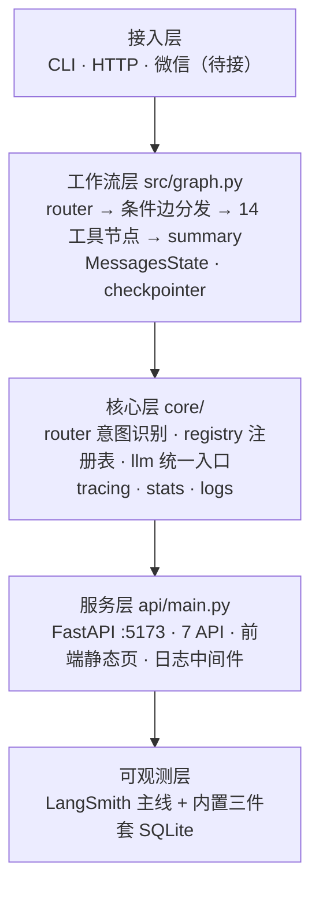
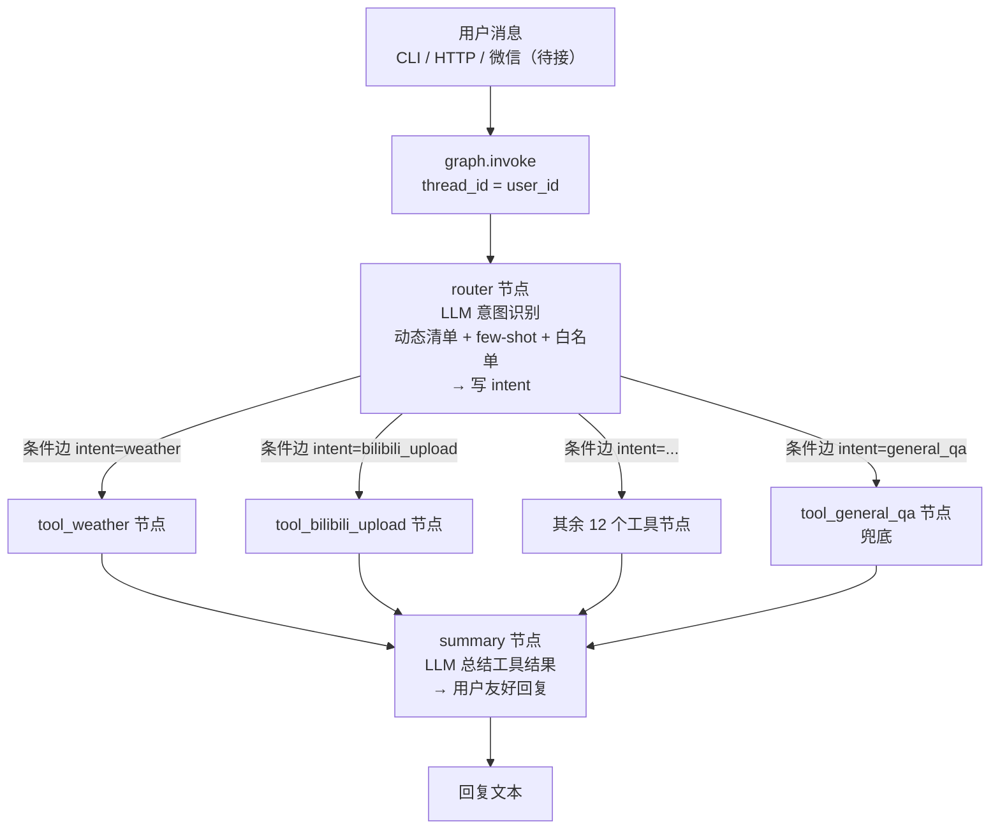

# 🧠 BrainFlow 智脑流

> 一站式企业级任务分配工作流智能助手 —— 统领全局的任务分配中枢，多渠道可接入（微信 / CLI / HTTP / 更多平台）。


### 项目信息

| 项 | 内容 |
| --- | --- |
| **作者** | 黄宇然（huangyuran） |
| **版本** | v1.1（2026-08-10） |
| **技术栈** | Python 3.11+ · LangGraph 1.x · FastAPI · SQLite · React 19 + Vite |
| **代码位置** | `D:\code\brainflow` |
| **相关文档** | [v1.0 方案总结](docs/V1.0_SUMMARY.md)（完整方案文档见 `docs/`） |
| **协议** | 专有 · © 2026 黄宇然，保留所有权利 |

> 详细方案文档见 `docs/`：`v3.1_architecture_final.md`（架构级）· `v3.1_implementation_final.md`（工程级）· `V1.0_SUMMARY.md`（v1.0 总结）· `DEBUG.md`（调试指南）· `frontend_options_2026.md`（前端选型）。

---

## 目录

- [项目简介](#项目简介)
- [核心特性](#核心特性)
- [架构设计](#架构设计)
- [快速开始](#快速开始)
- [项目结构](#项目结构)
- [API 接口](#api-接口)
- [配置说明](#配置说明)
- [开发与调试](#开发与调试)
- [可观测性](#可观测性)
- [常见问题](#常见问题-faq)
- [Roadmap](#roadmap)
- [License](#license)

---

## 项目简介

BrainFlow（智脑流）是基于 **标准 LangGraph 架构** 的企业级任务分配工作流平台。核心思想：

> **LLM 只做"听懂任务"（意图识别），任务怎么分配、怎么执行，由标准 LangGraph 工作流图编排完成——一个图统领全局，多渠道接入。**

**解决什么问题**：将"意图理解 → 任务分发 → 工具执行"的链路标准化、可观测化、可插拔化——加一个业务工具只需注册一行配置，工作流图自动扩展；每次执行全程可观测（节点状态 / 耗时 / 输入输出 / Token）。

### 生态定位：官方一套打底 + 自研前端

**LangGraph 官方生态（一套）**：`LangGraph 框架` + `LangSmith（观测/评估/Studio 调试）` + `Agent Chat UI（前端）`。

**BrainFlow 的采用**：采用官方**框架 + Server**做地基；**以 LangSmith 为主线**（观测/评估/Studio 调试搭配）；调试前端用 Agent Chat UI（本地子项目）；**在此基础上自研两套贴合业务的前端**——轻量内置面板（`:5173`）+ 完整运营看板（`web/`，`:5174`）——官方生态做地基，自研前端做产品。

```
官方（主线）：LangGraph 框架 + Server(:2024) + LangSmith/Studio + Chat UI(调试)
自研：内置面板(:5173) + 运营看板 web/(:5174) + SSE 流式对话 + 节点级观测 + FastAPI
```

---

## 核心特性

| 特性 | 说明 |
| --- | --- |
| **标准 LangGraph 工作流** | 一个 StateGraph：`router（意图识别）→ 条件边分发 → 14 工具节点 → summary（LLM 总结）→ 回复` |
| **任务分配中枢** | 意图识别后由条件边自动分发到对应工具节点；加工具 = 注册一行，图自动扩展 |
| **SSE 流式对话** | `/api/chat/stream` 按节点推送 router / tool / summary 进度，summary 产出时实时返回 reply |
| **运营看板前端** | `web/` 自研 React 看板：总览 / 链路追踪 / 工作流图 / AI 对话（SSE 流式） |
| **意图识别准确性** | 动态工具清单注入 + few-shot 示例 + 白名单校验防幻觉（评估脚本目标 ≥ 90%） |
| **统一 API 接口层** | FastAPI：7 个运维 API（对齐 Hermes）+ 同步/流式对话 + 工作流图 + 健康检查 |
| **节点级可观测** | 每节点记录**状态 / 耗时 / 输入输出 / Token**；metrics 按工具维度；JSON 结构化日志 |
| **官方生态原生兼容** | LangGraph Studio 图可视化 · Agent Chat UI 本地子项目 · LangSmith 观测主线 |
| **多渠道接入** | 微信（留空待接）/ CLI / HTTP / 更多平台——同一套工作流图 |
| **可插拔工具** | 注册表驱动（`register(name, fn, desc, keywords, examples)`），框架零改动 |

---

## 架构设计

### 分层架构



### 消息处理链路



---

## 快速开始

### 环境要求

| 依赖 | 版本 | 说明 |
| --- | --- | --- |
| Python | >= 3.11 | LangGraph / FastAPI 要求 |
| Node.js（可选） | >= 18 | 运营看板 `web/` 与 Agent Chat UI 需要 |

### 1. 安装依赖

```bash
python -m venv .venv
# Windows
.venv\Scripts\pip install -r requirements.txt
# macOS / Linux
.venv/bin/pip install -r requirements.txt
```

### 2. 配置环境变量

```bash
cp .env.example .env
```

编辑 `.env`，至少填写 LLM 配置（详细字段见 [配置说明](#配置说明)）：

```ini
LLM_MODEL=qwen3.7-max
LLM_API_KEY=your-api-key
LLM_BASE_URL=https://dashscope.aliyuncs.com/compatible-mode/v1
```

### 3. 启动

```bash
.venv\Scripts\python server\main.py
```

启动成功后：

- **内置前端**：http://localhost:5173（对话 / 工作流图 / 看板，SSE 流式对话）
- **Swagger 文档**：http://localhost:5173/docs
- 日志输出 JSON 结构化（每请求带 trace_id）

**（可选）启动运营看板**——需先启动后端，再另开终端：

```bash
cd web && npm install && npm run dev
```

- **运营看板**：http://localhost:5174（总览 / 链路追踪 / 工作流图 / AI 对话）

### 4. 验证

```bash
.venv\Scripts\python tests\validate.py        # 全链路验证（9 项，无需 LLM）
.venv\Scripts\python tests\intents_eval.py    # 意图识别准确率评估（需 LLM，目标 ≥ 90%）
```

---

## 项目结构

```
brainflow/
├── src/graph.py          ★ 标准工作流图（router + 条件边 + 工具节点 + summary 总结节点）
├── api/                  ★ API 接口层（FastAPI）
│   ├── main.py               7 API + /api/chat + /api/chat/stream + /api/graphs + 健康检查
│   └── static/index.html     内置前端（对话 SSE 流式 / 工作流图 / 看板 三标签页）
├── config/
│   ├── settings.py       全局配置（.env）
│   ├── profiles.py       LLM Profile 加载（${ENV} 注入）
│   └── prompts.py        意图识别 Router Prompt 全文
├── prompts/              ★ 提示词目录（各节点提示词按模块组织）
│   ├── __init__.py           统一导出
│   └── summary.py            summary 节点 Prompt（工具结果 → 用户友好回复）
├── core/
│   ├── router.py         RouterAgent.classify（LLM 意图识别 + 白名单）
│   ├── registry.py       ToolRegistry（工具注册表，可插拔）
│   ├── llm.py            LLMClient（OpenAI SDK 直连，token 统计）
│   ├── tracing.py        TraceSpan（节点级观测：状态/耗时/输入输出/token）
│   ├── stats.py          StatsCollector（指标）
│   └── logs.py           JsonLogger（JSON 结构化日志）
├── tools/wechat_tools.py 14 工具注册（stub，业务侧真实逻辑后续接入）
├── web/                  ★ 自研运营看板前端（React+Tailwind+shadcn/ui+AI SDK）
│   ├── src/pages/            总览看板 / 任务链路 / 工作流图 / AI 对话
│   ├── src/lib/              API 客户端 + SSE 流式封装 + 类型
│   └── vite.config.ts        dev 代理 /api → 后端 :5173
├── chat-ui/              Agent Chat UI 本地子项目（官方脚手架，调试聊天）
├── scripts/dev_debug.sh  一键启动调试环境（langgraph dev + 可选 chat-ui）
├── server/main.py        入口：uvicorn 起 API + CLI 模式（微信留空）
├── langgraph.json        LangGraph Server 图入口（langgraph dev 调试）
├── docs/                 调试 / 选型文档（DEBUG.md / frontend_options_2026.md 等）
├── data/                 运行时数据（SQLite）
└── tests/
    ├── validate.py       全链路验证（9 项，无需 LLM）
    └── intents_eval.py   意图识别准确率评估（目标 ≥ 90%）
```

---

## API 接口

统一由 `api/main.py`（FastAPI，端口 **5173**）提供，Swagger：`/docs`。

### 运维 API（7 个，对齐 Hermes）

| 方法 | 路径 | 说明 |
| --- | --- | --- |
| GET | `/api/board` | 看板总览（调用数 / token / 错误 / 错误率 / 活跃工具） |
| GET | `/api/tasks` | 任务列表（**节点级观测**：状态 / 耗时 / 输入输出 / token） |
| GET | `/api/profiles` | 工具使用分析（次数 / token） |
| GET | `/api/analytics/usage` | 使用统计（总数 + 按工具分布） |
| GET | `/api/logs?n=` | 最近调用日志 |
| GET | `/api/events` | SSE 实时事件流 |
| GET | `/` | 前端页面 |

### 业务 / 能力 API

| 方法 | 路径 | 说明 |
| --- | --- | --- |
| POST | `/api/chat` | 对话（同步）：`{"text": "...", "user_id": "..."}` → `{"reply": "..."}` |
| POST | `/api/chat/stream` | 对话（SSE 流式）：按节点推送 `step`（router/tool/summary），`reply` 在 summary 产出时返回 |
| GET | `/api/graphs` | 当前工作流图（官方 draw_mermaid 输出，前端 mermaid.js 渲染） |
| GET | `/healthz` | 存活检查 |
| GET | `/readyz` | 就绪检查（指标系统可用） |

---

## 配置说明

`.env` 全字段说明：

| 变量 | 必填 | 默认值 | 说明 |
| --- | --- | --- | --- |
| `LLM_MODEL` | ✅ | `qwen3.7-max` | 默认模型（对应 `llm_profiles.yaml`） |
| `LLM_API_KEY` | ✅ | — | LLM API Key |
| `LLM_BASE_URL` | ✅ | Dashscope | OpenAI 兼容端点 |
| `API_HOST` | 否 | `0.0.0.0` | API 监听地址 |
| `API_PORT` | 否 | `5173` | API 端口 |
| `DB_DIR` | 否 | `data/` | 观测数据库目录（可覆盖到可写目录） |
| `LANGSMITH_API_KEY` | 否 | — | LangSmith 观测（主线，langgraph dev 自动接入） |
| `WECHAT_ACP_PATH` | 否 | — | 微信接入（留空 = 未启用，后续实现） |

---

## 开发与调试

### CLI 模式（快速测试）

```bash
.venv\Scripts\python server\main.py --cli "深圳今天天气怎么样"
```

### 调试前端（共 4 个，全部本地化）

| # | 前端 | 类型 | 场景 | 启动 |
| --- | --- | --- | --- | --- |
| 1 | 内置面板（`api/static/`） | 自研 | 生产（对话/图/看板） | `python server/main.py` |
| 2 | **运营看板（`web/`）** | 自研 | 上线效果 · 追踪链路 · 工作流图 | `cd web && pnpm/npm install && npm run dev`（:5174） |
| 3 | Agent Chat UI（`chat-ui/`） | 官方脚手架 | 调试聊天 | `cd chat-ui && pnpm install && pnpm dev`（:3000） |
| 4 | 工作流图标签页（内置） | 自研 | 调试图可视化 | `draw_mermaid()` + mermaid.js 本地渲染 |

> 💡 **运营看板（`web/`）**：React 19 + Vite + TypeScript + **Tailwind CSS 4 + shadcn/ui + Vercel AI SDK**（对齐 DeerFlow / DeepAgent 选型）。含总览看板 / 任务链路追踪（节点级观测）/ 工作流图（mermaid）/ AI 对话（SSE 流式）四个页面。dev server 默认代理 `/api` → 后端 :5173，需先启动后端。

### LangGraph Server + Studio（调试后端）

```bash
pip install -U "langgraph-cli[inmem]"
langgraph dev          # :2024，终端输出 Studio 链接
```

> ⚠️ **Agent Chat UI 连不上（Failed to fetch）**：请先启动 `langgraph dev`（:2024），再在 Chat UI 配置 `Deployment URL = http://127.0.0.1:2024` + `Assistant ID = agent`。

### 一键脚本

```bash
bash scripts/dev_debug.sh            # langgraph dev + Studio 链接
bash scripts/dev_debug.sh --chat-ui  # + Agent Chat UI
```

### 测试

| 命令 | 覆盖 |
| --- | --- |
| `python tests/validate.py` | 图构建 / draw_mermaid / 工具节点 / API / 日志中间件 / 指标 |
| `python tests/intents_eval.py` | 意图识别准确率（测试集 17 条，目标 ≥ 90%） |

---

## 可观测性

**双层观测，LangSmith 为主线**：

| 层 | 能力 | 数据存储 | 启用方式 |
| --- | --- | --- | --- |
| **LangSmith**（主线） | 观测 / 评估 / Prompt 管理 / **Studio 调试搭配** | 官方 SaaS（云端） | `langgraph dev` 自动接入 |
| **内置三件套** | 工作流定义图 + 节点级观测（状态/耗时/输入输出/token）+ 指标 + JSON 日志 | SQLite（`observe.db`） | 默认开启 |

```env
# .env（LangSmith 观测）
LANGSMITH_API_KEY=lsv2_xxx
LANGSMITH_PROJECT=brainflow
LANGSMITH_TRACING=true
```

> ⚠️ **LangSmith 不需要单独"启动"**——它是云端 SaaS（`smith.langchain.com`），trace 上传到云端控制台查看，本地无法启动它。
>
> ⚠️ **内置服务（`python server/main.py`）不接 LangSmith**。内置 FastAPI 服务的观测链路是自研 `core/tracing.py` → SQLite，全程不调用 LangGraph/LangSmith 的 tracing，因此即使 `.env` 配好 key，内置服务也不会往 LangSmith 上传数据。
>
> LangSmith 只在**另一条链路**上生效：**先启动 `langgraph dev`（LangGraph Server，:2024）**，它会自动读取 `langgraph.json` + `.env` 并接入 LangSmith。启动成功后日志会出现 `Successfully submitted metadata to LangSmith instance`，表示 key 已生效。

**两条链路的启动对照**：

| 链路 | 启动命令 | 观测 | LangSmith 是否生效 |
| --- | --- | --- | --- |
| **内置面板**（生产） | `python server/main.py`（:5173） | 自研 SQLite 三件套 | ❌ 不接 |
| **LangGraph Server**（调试） | `langgraph dev`（:2024） | LangSmith 云端 + Studio 图可视化 | ✅ 自动接入 |

两个服务可同时运行、互不冲突：内置面板用于生产对话/看板，LangGraph Server 用于 Studio 调试图 + LangSmith 云端观测。

---

## 常见问题 FAQ

**Q1：Agent Chat UI 报 "Unable to connect to LangGraph server"？**
先启动后端：`langgraph dev`（确认 :2024 监听），再配置 Chat UI 的 Deployment URL = `http://127.0.0.1:2024`，Assistant ID = `agent`。

**Q2：端口 5173 被占用？**
`API_PORT=5175 python server/main.py`（或改 `.env` 的 `API_PORT`）。

**Q3：加一个新工具要改哪些代码？**
只需在 `tools/wechat_tools.py` 的 `TOOLS` 列表加一行注册（id/描述/触发词/例句），工作流图的条件边和前端自动扩展。

**Q4：怎么用 LangSmith / 为什么 trace 没上传？**
LangSmith 是云端 SaaS，不单独启动。它只在 `langgraph dev`（LangGraph Server）这条链路生效，且需先配置 `.env` 的 `LANGSMITH_API_KEY`。`python server/main.py` 的**内置服务不接 LangSmith**（用自研 SQLite 观测）。启动 `langgraph dev` 后看到 `Successfully submitted metadata to LangSmith instance` 即表示已接入，随后 trace 上传到 smith.langchain.com。

**Q5：Windows 启动 `langgraph dev` 报 `UnicodeDecodeError: 'gbk' codec`？**
Windows 默认用 GBK 解码，而 LangGraph 源码用 `open()` 读 JSON。启动前先设 `$env:PYTHONUTF8="1"` 和 `$env:PYTHONIOENCODING="utf-8"` 再运行 `langgraph dev`。

---

## Roadmap

| 阶段 | 内容 | 状态 |
| --- | --- | --- |
| 核心工作流（标准图 + 意图识别 + FastAPI + 前端） | — | ✅ 已完成 |
| summary 总结节点（工具结果 → LLM 友好回复） | — | ✅ 已完成 |
| SSE 流式对话（/api/chat/stream） | — | ✅ 已完成 |
| 运营看板前端（web/ React + shadcn/ui + AI SDK） | — | ✅ 已完成 |
| 节点级可观测（状态/耗时/输入输出/token） | — | ✅ 已完成 |
| LangSmith 观测接入（主线，langgraph dev 自动） | — | ✅ 就绪 |
| 意图识别评估优化（≥ 90%） | — | ✅ 实测 100%（17/17） |
| 工具真实逻辑接入 | 替换 `_stub` 为业务实现 | ⏸ 业务侧 |
| 微信接入 | WeChatBridge（weixin-acp） | ⏸ 留空 |
| checkpointer 生产化 | MemorySaver → SqliteSaver | ⏸ 待做 |
| 前端深化 | 运营看板功能完善 · 内置面板与 web/ 能力对齐 | 📋 进行中 |

---

## License

© 2026 黄宇然. 保留所有权利。
