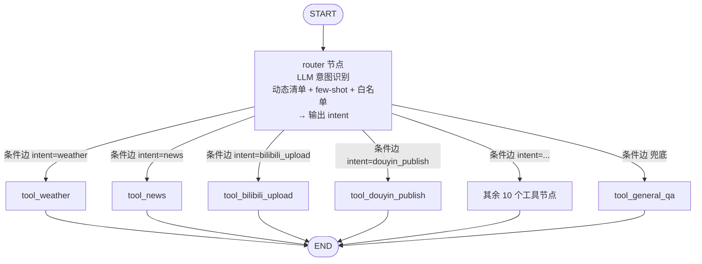
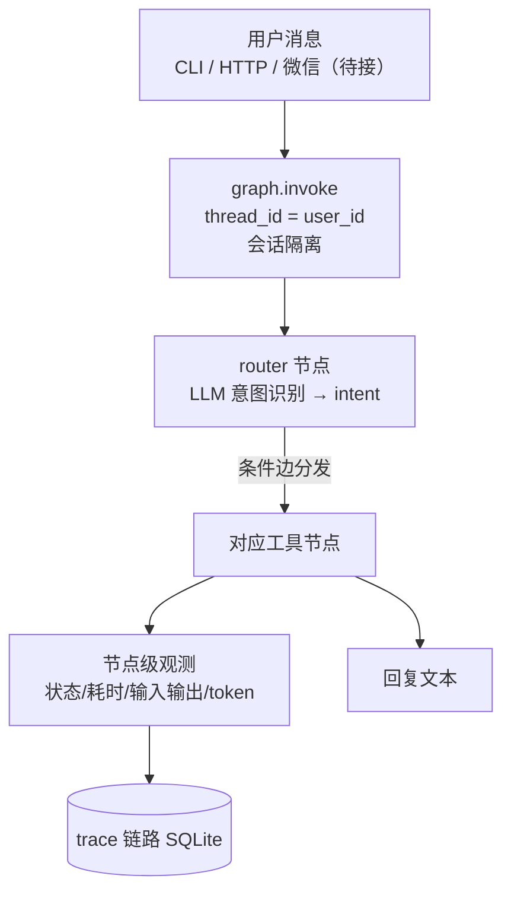
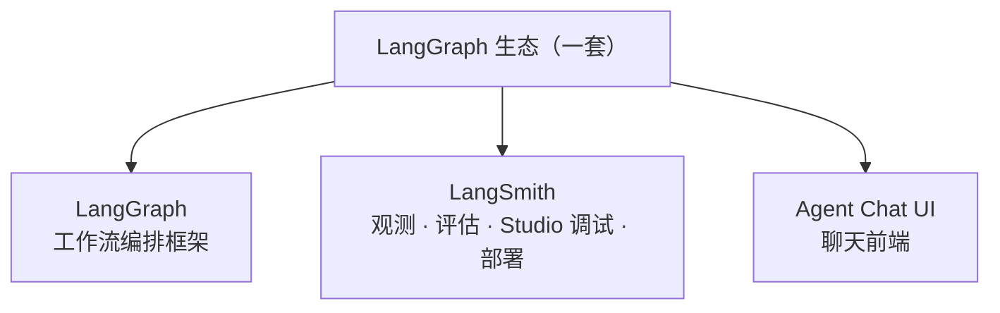
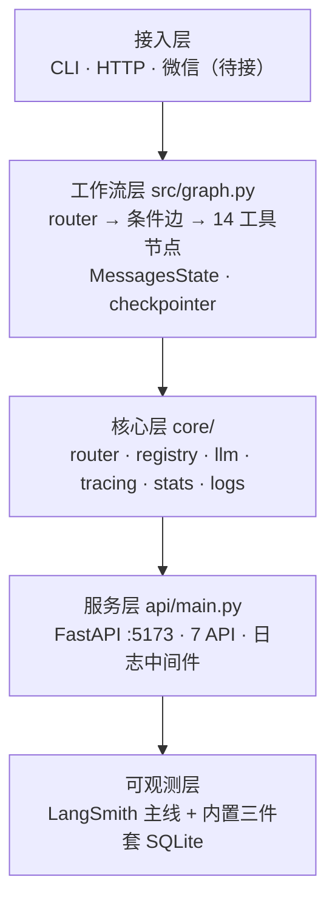

# BrainFlow 智脑流 — v1.0 方案总结

| 项目 | 内容 |
|------|------|
| 项目名 | **BrainFlow（智脑流）** |
| 版本 | v1.0 |
| 日期 | 2026-08-07 |
| 作者 | 黄宇然 |
| 代码 | `D:\code\brainflow` |
| 文档 | 架构方案 `v3.1_architecture_final.md` · 实现方案 `v3.1_implementation_final.md` |

---

## 1. 项目是什么

**一站式企业级任务分配工作流智能助手**——统领全局的任务分配中枢，多渠道可接入（微信 / CLI / HTTP / 更多平台）。

核心思想一句话：

> **LLM 只做"听懂任务"（意图识别），任务怎么分配、怎么执行，由标准 LangGraph 工作流图编排完成——一个图统领全局，多渠道接入。**

---

## 2. 工作流架构（整个项目的根本功能）★

### 2.1 工作流总览图（一个图统领全局）

**工作流 = 标准 LangGraph StateGraph**：`START → router 节点（意图识别）→ 条件边按 intent 分发 → 14 个工具节点 → END`。

### 2.2 消息执行链路（一次完整请求）

### 2.3 三大核心机制

| 机制 | 实现 | 说明 |
| --- | --- | --- |
| **① 意图识别**（router 节点） | `RouterAgent.classify()` | LLM 识别：动态工具清单 + few-shot 例句 + 白名单校验防幻觉 |
| **② 任务分发**（条件边） | `add_conditional_edges` | 按 intent 自动路由到对应工具节点，general_qa 兜底 |
| **③ 工具执行**（工具节点） | ToolRegistry 注册表 | 每个工具一个节点；**加工具 = 注册一行，图自动扩展** |

---

## 3. 核心特性

| 特性 | 说明 | 状态 |
| --- | --- | --- |
| 标准 LangGraph 工作流 | 一个 StateGraph：router 节点 → 条件边分发 → 14 工具节点 | ✅ |
| 任务分配中枢 | 意图识别后由条件边自动分发；加工具 = 注册一行 | ✅ |
| 意图识别准确性 | 动态清单 + few-shot + 白名单防幻觉；**实测 100%（17/17）** | ✅ |
| 统一 API 接口层 | FastAPI：7 运维 API + 对话 + 工作流图 + 健康检查 | ✅ |
| 日志系统 | uvicorn + JSON 结构化 + 请求中间件（trace_id） | ✅ |
| 节点级可观测 | 每节点：**状态 / 耗时 / 输入输出 / Token** | ✅ |
| 官方生态兼容 | LangGraph Server + Agent Chat UI + Studio（可选） | ✅ |
| 多渠道接入 | 微信（留空待接）/ CLI / HTTP | ⏸ 微信待接 |

---

## 4. 技术架构

### 4.1 生态定位

**LangGraph 生态（一套）**：LangGraph（框架）+ **LangSmith（观测/评估，Studio 调试内含其中，为主线）** + Agent Chat UI（前端）。

### 4.2 分层架构

### 4.3 技术栈

| 层 | 技术 |
| --- | --- |
| 工作流编排 | LangGraph 1.x（标准 StateGraph / MessagesState / checkpointer） |
| 意图识别 | OpenAI SDK 直连（自研 LLMClient + 动态清单 Prompt） |
| API / 日志 | FastAPI + uvicorn（JSON 结构化日志 + 请求中间件） |
| 数据 | SQLite（观测库 observe.db） |
| 前端 | 内置面板（原生 HTML + mermaid.js）+ Agent Chat UI（Next.js） |
| 观测 | LangSmith（主线，langgraph dev 自动接入）+ 内置三件套（SQLite） |

---

## 5. 功能清单

### 5.1 对话 💬

| 入口 | 说明 |
| --- | --- |
| 内置面板"对话"标签页 | Web 聊天 UI（消息气泡 + 输入框 + 耗时显示），`POST /api/chat` |
| Agent Chat UI（chat-ui/） | 官方聊天界面（调试用），连 LangGraph Server :2024 |
| CLI | `python server/main.py --cli "消息"` |
| 微信 | 留空待接（微信仅是渠道之一） |

### 5.2 任务调度分配 🎯

- **RouterAgent.classify()**：LLM 意图识别（动态工具清单 + few-shot + 白名单校验防幻觉）
- **条件边 route_by_intent**：按意图自动分发到对应工具节点（general_qa 兜底）
- **ToolRegistry 可插拔**：`register(name, fn, desc, keywords, examples)`——加工具 = 注册一行，条件边/前端自动扩展

### 5.3 任务链路追踪 🔍

- 每次请求 = 1 条 **trace**（trace_id / workflow / user / 状态 / 耗时）
- 每节点 = 1 个 **span**（节点 / 状态 / **耗时 / 输入 / 输出 / Token**）
- 存储 SQLite，Dashboard 看板页"最近任务"展开查看节点级详情

### 5.4 可观测性 📊

| 层 | 能力 | 数据 |
| --- | --- | --- |
| **LangSmith**（主线） | 观测 / 评估 / Prompt 管理 / **Studio 调试搭配**（langgraph dev 自动接入） | 官方 SaaS |
| 内置三件套（默认） | 节点级观测 + metrics（按工具）+ JSON 日志 | SQLite |

### 5.5 前端 UI 面板 🖥️

| # | 前端 | 类型 | 场景 |
| --- | --- | --- | --- |
| 1 | 内置面板（对话 / 工作流图 / 看板） | 自研 | **生产** |
| 2 | Agent Chat UI（chat-ui/） | 官方 | **调试聊天** |
| 3 | 工作流图标签页（draw_mermaid） | 自研 | 调试图可视化（本地 Studio 替代） |

### 5.6 意图识别（准确性专项）🧠

- 动态清单注入（14 工具 id + 描述 + 触发词）+ few-shot 例句 + 白名单校验
- 评估脚本 `tests/intents_eval.py`：17 条测试集 → **实测准确率 100%**（目标 ≥ 90%）

---

## 6. 现状盘点

| 项 | 状态 |
| --- | --- |
| 核心工作流（标准图 + 意图识别 + FastAPI + 前端） | ✅ 已完成，全链路验证 9/9 |
| 节点级可观测（状态/耗时/输入输出/token） | ✅ 已完成，实测通过 |
| 意图识别评估 | ✅ 100%（17/17） |
| LangSmith 观测接入（主线，langgraph dev 自动） | ✅ 就绪 |
| 工具真实逻辑 | ⏸ 业务侧（stub 替换即可） |
| 微信接入 | ⏸ 留空待接 |
| checkpointer 生产化（MemorySaver → SqliteSaver） | ⏸ 待做 |
| Agent Chat UI / Studio 联调 | ⏸ 需用户终端 `langgraph dev` |

---

## 7. v1.0 达成情况（对照最初需求）

| 最初需求 | v1.0 达成 |
| --- | --- |
| LangGraph 工作流，意图识别 + 路由分配 | ✅ 标准 StateGraph：router 节点 + 条件边分发 |
| 可观测性（看到节点执行状态） | ✅ 节点级观测（状态/耗时/输入输出/token）+ trace 链路 |
| 工作流架构可视化 | ✅ draw_mermaid + mermaid.js 渲染完整图 |
| 前端 UI 对话面板（不能太复杂） | ✅ 内置面板"对话"标签页 + Agent Chat UI（调试） |
| LangGraph Studio（调试）+ LangSmith 搭配 | ✅ **主线方案**：Studio 接入点就绪（langgraph dev） |
| 多渠道（微信仅是其一） | ⏸ CLI/HTTP 已通，微信留空待接 |
| 日志系统 + API 接口层（FastAPI） | ✅ 完成 |

---

© 2026 黄宇然
