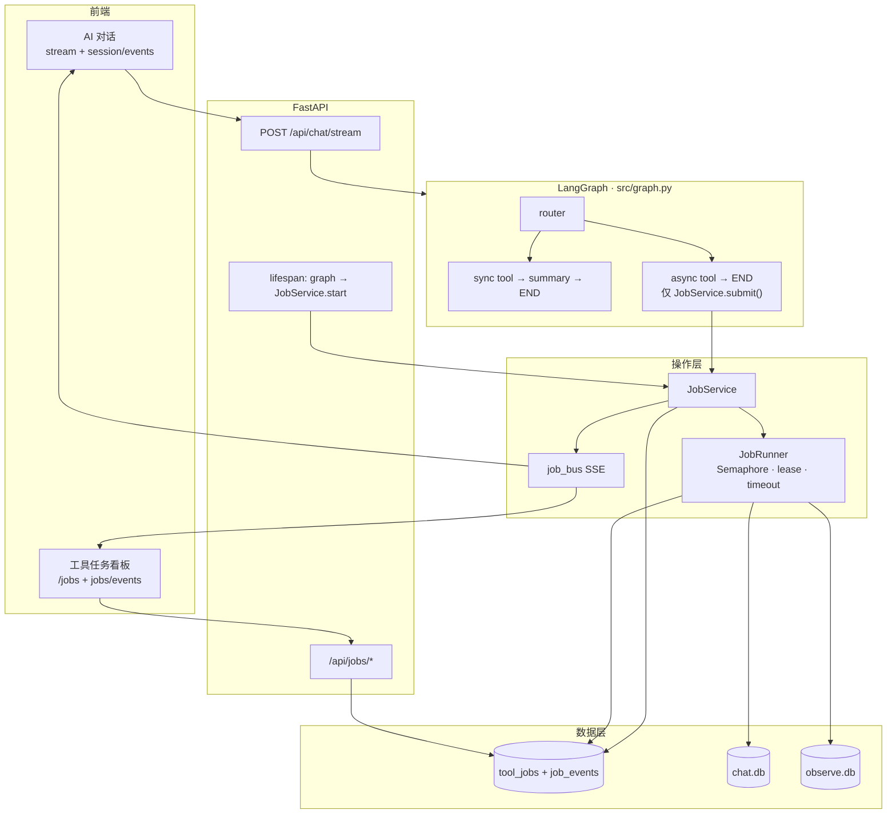
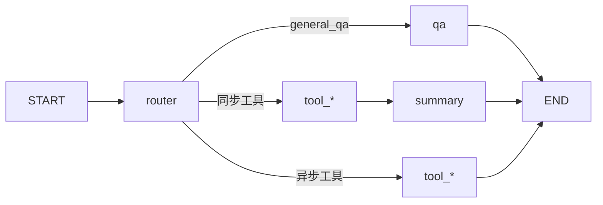
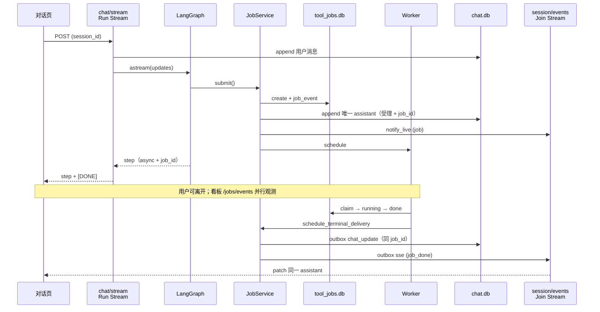
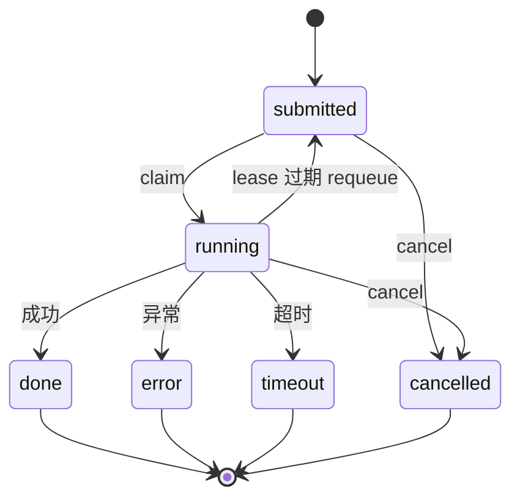
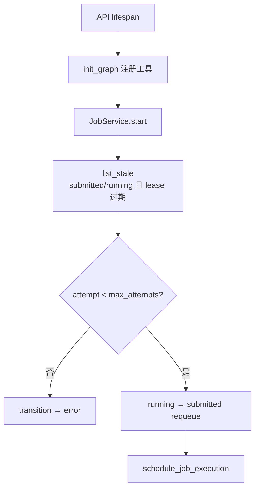
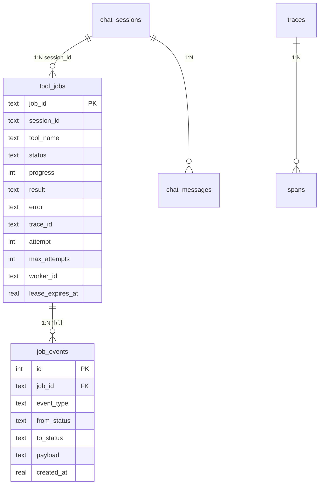

# BrainFlow 异步工具任务体系 — 架构与方案文档

> 版本：**v1.2** · 2026-08-12  
> 范围：LangGraph 工作流 + Tool Job 后台执行 + 对话/看板双端观测 + Run/Join 双 SSE

---

## 0. v1.2 变更摘要（相对 v1.1）

| 项 | v1.1 | v1.2（当前） |
|----|------|--------------|
| 异步工具 | 仅 `info_hunt` | `info_hunt` + `weather`（`ASYNC_TOOLS` 可扩展） |
| 对话 assistant | 受理 + 终态 **append 第二条** | **同一 job_id 一条**，终态 `chat_update` |
| SSE | 单通道混用 | **Run Stream**（`/chat/stream`）+ **Join Stream**（`/session/events`） |
| 持久化 submit | graph 节点写 chat | **`JobService.submit`** 唯一写入受理消息 |
| 图流 async 事件 | step + job + reply | 图流只推 **step**（含 `job_id`）；job 状态走 Join Stream |
| 前端 | merge 易重复 | `applyJobEventToMessages` + in-flight bind + dedupe |
| Outbox 终态 | `chat` append | **`chat_update`** 按 job_id 更新 |

---

## 1. 背景与目标

### 1.1 问题

部分工具（如 `info_hunt` 财税日报）执行耗时长（数十秒～数分钟）。若在 LangGraph 节点内同步阻塞：

- SSE 流式对话长时间无响应
- 用户离开页面后无法恢复进度
- API 进程重启会丢失内存中的执行任务

### 1.2 方案选型（方案 B）

| 阶段 | 行为 |
|------|------|
| Run Stream | `router → async tool submit` → 受理回执（含 `job_id`）→ **END**；图流只推 `step` |
| Join Stream | 会话/全局 SSE 推送 `job` → `job_done`；**patch 同一 job_id 的 assistant** |
| 后台 Worker | 执行工具 → `tool_jobs` 状态机 → outbox `chat_update` + SSE |
| 前端 | 对话：Graph Stream 绑 in-flight turn + Join Stream 补终态；看板：`/jobs` 全局 SSE |

**LangGraph 无 checkpointer**：工作流单轮无状态；会话记忆由 `chat.db` 承担展示职责。

### 1.3 设计原则

1. **图只编排，不执行长任务** — 符合 LangGraph 节点「短、纯、可序列化」惯例  
2. **Job 表是运行态权威** — `tool_jobs.db` 管状态；`chat.db` 管展示  
3. **单一写入口** — 状态变更必须走 `ToolJobStore.transition()`  
4. **可恢复** — 租约过期后可 requeue；进程启动时 `JobService.start()` 扫描  

> **图表约定**：下文 §2 为权威架构图；各章细节图与其保持一致。若有冲突，以 §2 为准。

---

## 2. 架构总览（权威）

### 2.1 总体分层



**读图要点**：

- **同步工具**走 `Sync` 路径，在 LangGraph _invoke 内完成，**不经过** JobService / Worker。
- **异步工具**走 `Async` 路径，节点只 `submit`，执行下沉到 Worker。
- **对话页**除 `stream` 外，还通过 `session/events` 订阅 job 推送（图中归并在 Chat 节点，接口见 §7）。
- **总览看板**读 `/api/board.tool_jobs`，跳转 `/jobs`（见 §8 补充）。

### 2.2 LangGraph 工作流拓扑



### 2.3 提交与后台执行时序



### 2.4 Job 状态机



### 2.5 模块职责

| 模块 | 路径 | 职责 |
|------|------|------|
| 状态机 | `core/job_state.py` | 合法状态迁移表 |
| Repository | `core/tool_jobs.py` | CRUD、`transition`、`claim`、`job_events` |
| 操作层 | `core/job_service.py` | 对外唯一编排入口 |
| Worker | `core/job_runner.py` | 并发执行、超时；终态走 outbox |
| Outbox | `core/job_outbox.py` | `chat_update` + `sse` 至少一次投递 |
| 投递载荷 | `core/job_delivery.py` | submit / 终态 update、大结果外置 |
| 事件总线 | `core/job_bus.py` | 内存 Queue；会话 + 全局 SSE |
| HTTP 层 | **`api/main.py`** | FastAPI 路由（见 §7）；lifespan 启 JobService |
| 工具注册 | `core/registry.py` | `async_execution` / `job_timeout_sec` 元数据 |
| 工作流图 | `src/graph.py` | LangGraph 节点与条件边 |

---

## 3. LangGraph 集成规范

> 工作流拓扑与状态机见 **§2.2 / §2.4**，本节只补充代码契约与生态边界。

### 3.1 WorkflowState

```python
class WorkflowState(MessagesState):
    intent: str
    tool_output: str
    session_id: str   # 来自 chat/stream payload
    job_id: str       # async 工具 submit 后写入
```

### 3.2 异步工具节点契约

- **允许**：读 state、调 `JobService.submit()`、写 span、返回 `AIMessage` 受理回执  
- **禁止**：在节点内 `await` 长 IO、**写 `chat.db`**（submit 由 JobService 统一持久化）、直接操作 Worker  

当前 `async_execution=True` 的工具（`tools/wechat_tools.py` → `ASYNC_TOOLS`）：

| 工具 | 超时 | 说明 |
|------|------|------|
| `info_hunt` | 600s | 财税日报 / 政策检索 |
| `weather` | 120s | 天气查询 |

同步工具仍为 `tool → summary → END`，**不经 JobService**。

```python
# src/graph.py · make_async_tool_node
job = get_job_service().submit(
    tool_name=name,
    session_id=state.get("session_id", ""),
    user_query=text,
    trace_id=get_tracer().current_trace_id(),
)
return {
    "job_id": job["job_id"],
    "tool_output": receipt,
    "messages": [ToolMessage(...), AIMessage(content=receipt)],
}
```

### 3.3 与 LangGraph 生态的边界

| 能力 | BrainFlow 做法 |
|------|----------------|
| 会话记忆 | **不用** checkpointer；`chat.db` 持久化 |
| 人机中断 | 暂未用 `interrupt()`；取消走 `POST /api/jobs/{id}/cancel` |
| Studio / langgraph.json | `get_graph()` 不变，图结构可可视化 |
| 流式 | Run：`astream(updates)` 只推 step；Join：`session/events` 推 job 终态 |

### 3.4 Run Stream / Join Stream

| 通道 | 端点 | 职责 |
|------|------|------|
| **Run Stream** | `POST /api/chat/stream` | 图执行至 END（async 为 submit）；只推 `step` |
| **Join Stream** | `GET /api/chat/sessions/{id}/events` | 后台 job；按 `job_id` upsert 同一条 assistant |
| **看板 Stream** | `GET /api/jobs/events` | 全局 Kanban；与 Join **并行**，共用 `job_bus` |

前端：`web/src/lib/chat-messages.ts` → `applyJobEventToMessages`；图流进行中忽略 Join 的 `job`/`snapshot`。

---

## 4. 核心流程

> 主时序见 **§2.3**；本节补充启动 recovery。

### 4.1 启动恢复（lifespan）



---

## 5. 数据层

> 状态机见 **§2.4**；本节补充表结构与存储分工。

### 5.1 ER 关系



### 5.2 存储分工

| 存储 | 权威职责 | 消费者 |
|------|----------|--------|
| `tool_jobs` | 运行态、结果快照 | 看板、recovery、API |
| `job_events` | 状态迁移审计 | 排障、未来 SSE replay |
| `chat_messages` | 用户可见对话 | 对话页历史 |
| `observe.db` | trace/span 观测 | 任务链路页 |

**唯一写入口**：`ToolJobStore.transition()` — 校验 `job_state.TRANSITIONS` 并追加 `job_events`。

---

## 6. 操作层

### 6.1 JobService API（内部）

| 方法 | 说明 |
|------|------|
| `submit(tool_name, session_id, user_query, trace_id)` | 创建 job、notify、入队 Worker |
| `cancel(job_id)` | 非终态 → cancelled |
| `recover_stale_jobs()` | 启动时接管过期 lease |
| `notify(job, event_type)` | 推送 job_bus（会话 + 全局） |
| `list_events(job_id, since)` | 读审计表 |

### 6.2 JobRunner Worker

| 机制 | 默认值 | 说明 |
|------|--------|------|
| 并发 | `Semaphore(5)` | 防止线程池被打满 |
| 租约 | 300s | `claim` 时写入 `lease_expires_at` |
| 超时 | registry `job_timeout_sec` | `info_hunt` 600s |
| 重试 | `max_attempts` | recovery 时检查 |
| Trace | 恢复 `trace_id` | 后台 span 挂回原 trace |

### 6.3 工具 Registry 元数据

```python
reg.register(
    "info_hunt", fn,
    async_execution=True,
    job_timeout_sec=600,
    job_max_attempts=2,
    ...
)
```

---

## 7. HTTP / SSE 接口

### 7.1 对话

| 方法 | 路径 | 说明 |
|------|------|------|
| POST | `/api/chat/stream` |  body 含 `session_id`；async 工具推送 `job` 事件 |
| GET | `/api/chat/sessions/{id}/jobs` | 会话 active jobs |
| GET | `/api/chat/sessions/{id}/events` | 会话级 SSE（snapshot + replay(since) + 实时） |

### 7.2 看板

| 方法 | 路径 | 说明 |
|------|------|------|
| GET | `/api/jobs` | 列表 + summary |
| GET | `/api/jobs/{id}` | 单 job |
| GET | `/api/jobs/{id}/events` | 事件时间线 |
| GET | `/api/jobs/{id}/result` | 下载外置大结果（result_ref） |
| POST | `/api/jobs/{id}/cancel` | 取消 |
| GET | `/api/jobs/events` | 全局 SSE（支持 `?since=` replay） |

### 7.3 SSE 事件类型

| type | 场景 |
|------|------|
| `snapshot` | 连接建立时全量/会话 jobs |
| `job` | 状态变更 |
| `job_done` | 成功终态 |
| `job_error` | 失败/取消/超时 |
| `heartbeat` | 15s 保活 |
| `replay` | （job 事件字段）基于 `job_events` 补发，前端断线重连 |

---

## 9. 已知限制与演进

### 9.1 已实现（P2）

| 项 | 实现 |
|----|------|
| **Outbox** | `job_outbox` 表；终态 `chat_update` + `sse` 两条记录，至少一次投递 |
| **SSE replay** | `GET .../events?since=` 基于 `job_events` 补发；重连时跳过 snapshot |
| **大结果外置** | `>8000` 字写入 `data/job_results/{job_id}.txt`，DB 存摘要 + `result_ref` |
| **独立 Worker** | `server/job_worker.py` — 可与 API 并行跑 outbox + recovery（执行仍由 API 进程 schedule） |

### 9.2 当前限制

| 项 | 说明 |
|----|------|
| 单进程执行 | `schedule_job_execution` 仍绑定 API 进程 asyncio；多实例需外部队列 |
| SSE 实时通道 | `job_bus` 仍为内存队列；断线靠 replay + snapshot 补态 |
| progress | 阶段值（0/10/100），非工具真实进度 |
| Outbox 与 Job 终态 | 非同一 SQLite 事务；极端崩溃时可能 job=done 但 chat 尚未投递（outbox 会重试） |

### 9.3 可选后续

1. **Redis/Postgres 队列** — 多 API + 多 Worker 水平扩展  
2. **LangGraph interrupt** — 高危工具提交前人机确认  
3. **对象存储** — `result_ref` 从本地文件迁到 S3/OSS  
---

## 8. 前端观测（§2.1 补充）

总览页读 `/api/board.tool_jobs.active`，不在 §2.1 主链路中，作为入口汇总：

| 页面 | 数据源 | 行为 |
|------|--------|------|
| AI 对话 | `chat/stream` + `session/events` | Run 绑 turn → Join patch；切走可恢复 |
| 工具看板 `/jobs` | `/api/jobs` + `jobs/events` | Kanban 四列；**与对话独立观测，完全兼容** |
| 总览 `/` | `board.tool_jobs` | 进行中任务数，链到看板 |

---

## 10. 目录索引

```
core/
├── job_state.py      # 状态机
├── tool_jobs.py      # Repository + job_events
├── job_outbox.py     # Outbox 投递
├── job_delivery.py   # 终态载荷 + 大结果外置
├── job_service.py    # 操作层入口
├── job_runner.py     # Worker
├── job_bus.py        # SSE 推送
└── registry.py       # 工具元数据

src/graph.py          # LangGraph 图（async 节点仅 submit）

api/main.py           # FastAPI HTTP 层（见下文「api 包说明」）
server/main.py        # 进程入口：uvicorn api.main:app
server/job_worker.py  # 可选：独立 outbox worker

web/src/
├── pages/jobs/       # Kanban 看板
├── pages/chat/       # 对话 + session events
└── lib/job-board.ts  # 分列逻辑
```

---

## 12. `api/` 包说明

项目里的 **`api` 不是 npm 包**，而是 Python 侧的 **HTTP 接口层**：

```
brainflow/
├── api/
│   └── main.py          # FastAPI app：所有 /api/* 路由、lifespan
├── server/
│   └── main.py          # 启动入口：uvicorn.run("api.main:app", ...)
└── web/src/lib/api.ts   # 前端 TS 客户端（Vite 别名 @/lib/api，调用上述 HTTP API）
```

| 名称 | 是什么 |
|------|--------|
| **`api/`（Python）** | FastAPI 应用模块；`from api.main import app` 用于测试与 uvicorn |
| **`@/lib/api`（前端）** | `web/src/lib/api.ts`；`fetch('/api/...')` 封装，经 Vite 代理到后端 |
| **`/api`（URL 前缀）** | 所有 REST/SSE 路径前缀，如 `/api/chat/stream`、`/api/jobs/events` |

**分工**：`core/` + `src/` 是业务与图；**`api/main.py` 只做 HTTP 适配**（参数校验、SSE 封装、挂载静态资源），不包含 Job 状态机逻辑。

---

## 11. 验收清单

- [ ] 触发 `info_hunt` / `weather`：Run Stream 立即 `[DONE]`，**仅一条** assistant
- [ ] 离开对话再进入：session events + jobs 恢复 running，完成后 **同条** 更新为结果
- [ ] 看板 `/jobs`：与对话 **并行** 显示任务列迁移，不受对话 dedupe 影响
- [ ] `POST /api/jobs/{id}/cancel`：终态 cancelled，对话 + 看板均收到 `job_error`
- [ ] 重启 API：lease 过期 job requeue；outbox `chat_update` 补投递
